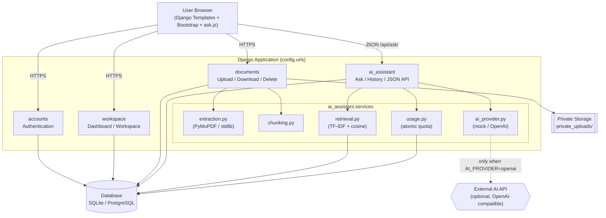

# Architecture Diagram

## Mermaid



## Lucidchart-compatible specification

Recreate the diagram with these nodes and directed edges.

**Nodes**

| ID       | Label                                   | Shape          |
| -------- | --------------------------------------- | -------------- |
| browser  | User Browser                            | Rounded rect   |
| auth     | accounts (Authentication)               | Rectangle      |
| ws       | workspace (Dashboard)                   | Rectangle      |
| docs     | documents (Upload/Download/Delete)      | Rectangle      |
| ai       | ai_assistant (Ask/History/API)          | Rectangle      |
| extract  | extraction.py (PyMuPDF/stdlib)          | Rectangle      |
| chunk    | chunking.py                             | Rectangle      |
| retrieve | retrieval.py (TF-IDF + cosine)          | Rectangle      |
| provider | ai_provider.py (mock/OpenAI)            | Rectangle      |
| usage    | usage.py (atomic quota)                 | Rectangle      |
| db       | Database (SQLite/PostgreSQL)            | Cylinder       |
| storage  | Private Storage (private_uploads/)      | Document/Store |
| extai    | External AI API (optional)             | Hexagon        |

**Edges (source → target, label)**

```
browser -> auth        (HTTPS)
browser -> ws          (HTTPS)
browser -> docs        (HTTPS, multipart upload)
browser -> ai          (JSON /api/ask/, CSRF token)
auth -> db
ws -> db               (live stats)
docs -> extract
docs -> chunk
docs -> storage        (write/read private files)
docs -> db
ai -> usage
ai -> retrieve
ai -> provider
ai -> db               (save AIRequest)
retrieve -> db         (load chunks)
usage -> db            (UsageRecord, atomic)
provider -> extai      (dashed; only when AI_PROVIDER=openai)
```

**Groupings (containers):** put `auth, ws, docs, ai` inside a "Django
Application" container, and `extract, chunk, retrieve, provider, usage` inside
an "ai_assistant.services" sub-container.
