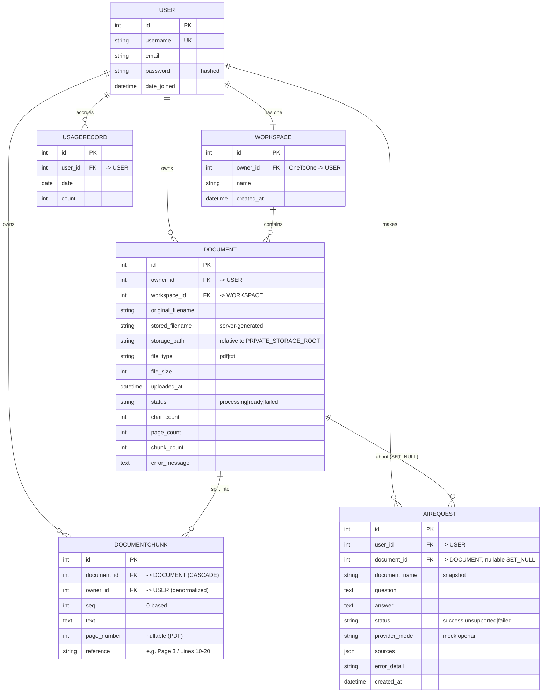

# Database ERD

This ERD matches the Django models in `workspace/models.py`,
`documents/models.py`, and `ai_assistant/models.py`.

## Keys, constraints & indexes

- **WORKSPACE.owner** — `OneToOne` to `USER` (`CASCADE`): one workspace per user.
- **DOCUMENT** — FKs to `USER` and `WORKSPACE` (`CASCADE`). Indexes on
  `(owner, -uploaded_at)` and `status`.
- **DOCUMENTCHUNK** — FK to `DOCUMENT` (`CASCADE`) and denormalized FK to
  `USER`. `unique_together (document, seq)`; indexes on `(document, seq)` and
  `owner`.
- **AIREQUEST** — FK to `USER` (`CASCADE`); FK to `DOCUMENT` is
  **`SET_NULL`** so history survives document deletion (with `document_name`
  preserved). Indexes on `(user, -created_at)` and `status`.
- **USAGERECORD** — `UniqueConstraint(user, date)` prevents duplicate daily
  records; index on `(user, date)`.

## Deletion behavior

| Action              | Effect                                                        |
| ------------------- | ------------------------------------------------------------- |
| Delete User         | Cascades to Workspace, Documents, Chunks, AIRequests, Usage   |
| Delete Workspace    | Cascades to its Documents (and their Chunks)                  |
| Delete Document     | Cascades to Chunks; sets `AIRequest.document = NULL` (history kept); stored file removed |
